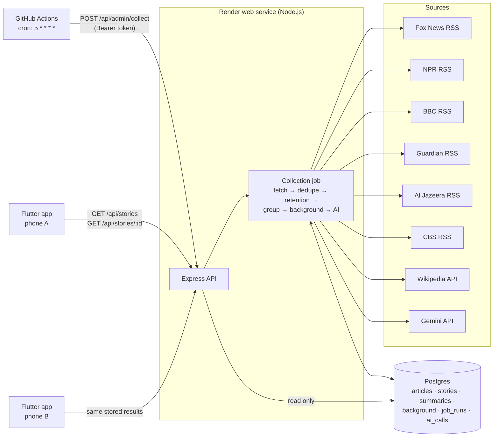

# My News

CS 403 project: an AI-assisted news service. A server collects news every hour, groups different publishers' coverage of the same event into one **story**, attaches background links, and generates a grounded AI overview and perspectives once per story. A Flutter app shows the stored results to every reader.

| Part | Folder | Technology |
| --- | --- | --- |
| Backend API + hourly worker | [server/](server/) | Node.js 22+, Express, PostgreSQL (SQLite locally) |
| AI prompts and model config | [server/prompts/](server/prompts/) | Google Gemini API (`gemini-3.8-flash`, free tier, structured JSON output); Claude or other OpenAI-compatible APIs selectable |
| Mobile client | [app/](app/) | Flutter / Dart (Android release APK) |
| Hourly schedule | [.github/workflows/hourly-collect.yml](.github/workflows/hourly-collect.yml) | GitHub Actions cron |
| Hosting | [render.yaml](render.yaml) | Render web service + Neon Postgres |
| Starter project (reference only) | [myNews/](myNews/) | Original HTML/JS reader |

Supporting documents: [Verification evidence](docs/VERIFICATION.md) · [Grouping examples](docs/GROUPING_EXAMPLES.md) · [AI summary review](docs/AI_REVIEW.md) · [Release notes](docs/RELEASE_NOTES.md) · [Defect log](docs/DEFECT_LOG.md) · [AI development reflection](docs/AI_REFLECTION.md) · [Demo checklist](docs/DEMO_CHECKLIST.md)

**Deployed API:** https://mynews-api.onrender.com

**Demo shown on an iPhone via the Flutter web build (no Android device or Mac available); the Android APK is included.** The web build is the same Flutter code, published by [web-pages.yml](.github/workflows/web-pages.yml) at https://digiey-tech.github.io/my-news/ and opened in Safari (Share → Add to Home Screen for full screen).

---

## Architecture



**Server/client boundary.** The Flutter app only calls `GET /api/stories` and `GET /api/stories/{id}`. It never fetches RSS feeds, never groups articles, and never calls an AI model. Opening the app, pulling to refresh, or tapping an AI button reads results already stored in Postgres. Only the hourly job (or a protected admin call) fetches news and calls the AI model. Two phones therefore read the exact same stored summary (same `version` and `generated_at`), and the `ai_calls` table shows no new model calls caused by reads.

**Credentials** (`GEMINI_API_KEY`, `DATABASE_URL`, `ADMIN_TOKEN`) exist only as server environment variables. The Flutter build contains only the public API URL. [server/.env.example](server/.env.example) has placeholders, and `.env` is git-ignored.

## Data model

All timestamps are ISO-8601 UTC strings; the app converts them to local time for display. Full schema: [server/src/schema.sql](server/src/schema.sql).

| Table | Purpose | Key columns |
| --- | --- | --- |
| `articles` | One publisher's report | `id` = SHA-1 of normalized URL (stable), `publisher`, `title`, `excerpt` (feed text), `url`, `published_at`, `published_at_source` (`feed`/`first_seen`), `first_seen_at`, `last_seen_at`, `content_hash`, `story_id` |
| `stories` | One event | `id` (stable, derived from founding article), `headline`, `created_at`, `updated_at`, `latest_article_at`, `input_hash` (hash of member ids + content), `keywords`, `background_hash` |
| `summaries` | Stored AI analysis per story | `version`, `input_hash` it was built from, `article_ids` it used, `payload` (JSON), `model`, `prompt_version`, `input_scope`, `generated_at`, last-attempt status/error |
| `background_resources` / `story_background` | Wikipedia links and which stories use them | `title`, `description`, `url`, `source`, `matched_term` |
| `feed_status` | Last attempt/success/error per feed | `last_success_at`, `last_error`, `last_item_count` |
| `job_runs` | Operational log of every collection run | `trigger`, `started_at`, `finished_at`, `status`, article/story/summary counts, `notes` |
| `ai_calls` | One row per model call (no text) | `story_id`, `called_at`, `model`, `outcome`, token counts |

## API

Base URL: the deployed service. All responses are JSON. Reads have no side effects.

### `GET /api/stories`
Story list, newest first ("top stories" = most recent latest-article time within the last 7 days).

```json
{
  "server_time": "2026-10-21T02:05:00.000Z",
  "ordering": "newest first (latest article publication time)",
  "retention_hours": 168,
  "last_successful_collection_at": "2026-10-21T02:04:50.793Z",
  "last_run": { "id": "job_...", "trigger": "schedule", "started_at": "...", "finished_at": "...", "status": "success" },
  "count": 192,
  "stories": [
    {
      "id": "st_9c813fb9d24cc2a0",
      "headline": "Florida puts 77-year-old man to death for deputy's murder as state closes in on execution record",
      "latest_article_at": "2026-10-21T01:52:20.000Z",
      "updated_at": "2026-10-21T02:01:46.022Z",
      "publisher_count": 3,
      "article_count": 3,
      "publishers": ["CBS News", "Fox News", "The Guardian"],
      "ai_status": "ready"
    }
  ]
}
```

### `GET /api/stories/{id}`
Complete story detail. `404` with a readable message if the story expired.

```json
{
  "id": "st_...", "headline": "...", "updated_at": "...", "latest_article_at": "...",
  "publisher_count": 3, "article_count": 3, "keywords": ["florida", "execution"],
  "excerpt_notice": "Excerpts are the publishers' original feed text, not full articles. ...",
  "publishers": [
    { "name": "CBS News", "articles": [
      { "id": "3b3b...", "title": "...", "url": "https://www.cbsnews.com/...", "excerpt": "...",
        "published_at": "...", "published_at_estimated": false } ] }
  ],
  "background": {
    "status": "available | none",
    "message": "No background resource available",
    "resources": [ { "title": "Florida", "description": "U.S. state", "url": "https://en.wikipedia.org/wiki/Florida", "source": "Wikipedia", "matched_term": "Florida" } ]
  },
  "ai": {
    "label": "AI-generated",
    "status": "ready | outdated | pending | failed | unavailable",
    "message": "explanation when not ready",
    "analysis": {
      "overview": "...", "overview_refs": [1, 2],
      "agreement": "...", "agreement_refs": [1],
      "disagreement": "...", "disagreement_refs": [],
      "uncertainty": "...",
      "perspectives_status": "supported | insufficient_evidence",
      "perspectives": [ { "id": "p1", "name": "Supporters: ...", "summary": "...", "evidence_limits": "...", "refs": [1] } ],
      "references": [ { "ref": 1, "article_id": "...", "publisher": "CBS News", "title": "...", "url": "...", "available": true } ],
      "generated_at": "...", "model": "gemini-3.8-flash", "version": 2, "prompt_version": "summary-v1",
      "input_scope": "RSS feed excerpts (headline and short description), not full article text"
    }
  },
  "last_successful_collection_at": "..."
}
```

AI `status` meanings: **ready** (current), **outdated** (valid but newer articles joined; shown with a warning, regenerated next run), **unavailable** (it cited an article that has expired, so it is hidden), **failed** (generation failed; no text is shown), **pending** (not generated yet).

### Other endpoints
- `GET /api/status`: last successful collection, last 48 job runs, per-feed status, AI call counts. Evidence for the hourly schedule.
- `GET /health`: database connectivity check.
- `POST /api/admin/collect`: runs one collection. Requires `Authorization: Bearer <ADMIN_TOKEN>`; returns `401` otherwise. Used by the scheduler and for instructor demos.

## Collection and retention

Each run ([server/src/collector.js](server/src/collector.js)):

1. **Fetch** 8 feeds from 6 publishers in parallel (Fox News, NPR, BBC News ×2, The Guardian ×2, Al Jazeera, CBS News; [server/src/feeds.js](server/src/feeds.js)). Each feed has a 15-second timeout; a failed feed is recorded in `feed_status` and the job's notes, and the run continues.
2. **Normalize and dedupe.** HTML and newsletter boilerplate are stripped from excerpts. The URL is normalized (https, lowercase host, no `www.`, no fragment, tracking parameters such as `utm_*`/`at_*` removed, trailing slash removed) and hashed into the article id. Re-fetching a known URL updates that row (`last_seen_at`, text if it changed) instead of inserting a copy. Inside one run, the first copy of a URL wins, so an article present in two BBC feeds does not flip between versions.
3. **Retention** (rolling 168 hours by **publication time**). Articles with `published_at` older than 168 hours are deleted. Then, in the same transaction:
   - summaries that cite a deleted article are cleared (`payload = NULL`) and regenerated later in the run from the remaining articles;
   - stories with no remaining articles are deleted with their summaries and background associations;
   - background resources no longer linked to any story are deleted (the resources themselves may describe older events);
   - `ai_calls` rows for deleted stories older than the window are removed. `job_runs` keeps only counts and short notes, never article text or summaries.

   Between runs, the API also filters by the 168-hour cutoff at read time, so an article that crosses the boundary disappears immediately, and an AI analysis that cited it is reported as `unavailable` instead of being shown.
4. **Group** new articles into stories (below), then recompute each story's headline, latest time, and input hash.
5. **Background** lookup for stories whose input changed (max 60 per run).
6. **AI summaries** for stories whose input hash changed (max `MAX_AI_CALLS_PER_RUN`, 4 in production, multi-publisher stories first, calls spaced `AI_MIN_INTERVAL_MS` apart; no new call starts after `AI_RUN_BUDGET_MINUTES`, default 8, of AI work, so a slow provider cannot stall the run). Unchanged stories are never sent to the model again. If the provider answers HTTP 429 (free-tier quota), the run stops calling the model and the remaining stories stay "pending" until the next hour; they are not marked as failed. With `AI_MIN_PUBLISHERS=2`, single-source stories get no analysis and the app says so (status `skipped`).
7. **Job record** with status `success` / `partial` (some feed or AI failures) / `failed` (no feed worked or crash), counts, and notes. A lock prevents two overlapping runs.

**Missing or invalid publication dates.** If a feed item has no date, an unparseable date, or a date more than 60 minutes in the future, the article's `published_at` is set to the time we first saw it and `published_at_source = 'first_seen'`. Later re-fetches keep that first-seen time (they never reset it), so the article still expires 168 hours after we first collected it. The app labels such times "time first seen; feed gave no date". Items already older than 168 hours when fetched are ignored.

## Grouping method

Implemented in [server/src/grouping.js](server/src/grouping.js) and [server/src/text.js](server/src/text.js).

1. Each article becomes a TF-IDF vector of its title (counted twice) and excerpt after stop-word removal and light stemming.
2. **Entity tokens** are taken from capitalized words (people, places, organizations). A capital only counts when position does not explain it: the first word of a sentence and words in Title Case Headlines count only if the same word is capitalized mid-sentence somewhere. Titles and generic place words (President, Senator, County, Council...) are not entities.
3. Two articles **match** only if they were published within 48 hours of each other, share at least two distinctive terms, neither is a multi-topic roundup ("Morning news brief", "The Papers", live blogs), and one of these holds:
   - cosine similarity ≥ 0.50; or
   - cosine ≥ 0.32, at least one shared **event term** (a shared word that is not a name, e.g. *merger*, *recall*, *execution*), and the articles do not name entirely different people/places; or
   - cosine ≥ 0.20, at least one shared event term, and at least two shared entity tokens.

   Sharing a single keyword, or only a person's name, is never enough.
4. Existing articles keep their story. New articles are processed oldest first. Each joins the story containing its best match, but only if it also resembles the story as a whole (cosine to the story centroid ≥ 0.22). This stops chains where A≈B and B≈C but A and C are different events. Otherwise the article founds a new single-source story.
5. Story IDs derive from the founding article's ID and never change, so new coverage joins the existing story instead of creating a duplicate entry. The headline is the member title most similar to the other members.

**Known mistakes.**
- *Same disease, different countries:* live data on 2026-10-21 merged "Nigeria confirms an Ebola case in Abuja" with "Is Ebola under control in Kenya after nine cases confirmed?" because the Nigeria excerpt also mentions Kenya and both share *Ebola*, *case*, and *confirmed*. Someone following the outbreak might want them together; someone following Nigeria would not.
- *Ongoing political themes:* several articles about Trump's midterm spending were grouped as one story, though they were published by different outlets about slightly different campaign events.
- *Too strict:* pairs with very different wording (e.g. "Man charged with attack on Australia MP" vs a live blog about the same case) can stay separate, so a story may show fewer publishers than actually covered it.

Examples with live and fixture data: [docs/GROUPING_EXAMPLES.md](docs/GROUPING_EXAMPLES.md). Reproduce live grouping without touching the database: `cd server && node scripts/grouping-report.js --pairs`.

## Background resources

Implemented in [server/src/background.js](server/src/background.js). The server, not the app, selects resources:

1. Collect capitalized phrases from the story's titles and excerpts. Keep phrases that appear in at least two of its articles (or in the title of a single-article story), preferring multi-word names. A single word must be a real name (capitalized mid-sentence) and not part of a longer name already found.
2. Search English Wikipedia for each phrase. Accept a page only when every word of its title, including any qualifier like "(Brazil)", appears in the story text; a single-word term must match the title word exactly, and acronyms must match in capitals (so "ICE" never links the page "Ice", and "Eagles" never links "Eagle").
3. Keep up to two pages per story. Their labels describe the resource ("Wikipedia: Strait of Hormuz", plus Wikipedia's short description). If nothing passes, the app shows **"No background resource available"**.

## AI summaries and perspectives

- **Where:** server only ([server/src/ai.js](server/src/ai.js)), during the collection run.
- **Model:** Google Gemini `gemini-3.8-flash` (free tier) through Gemini's OpenAI-compatible endpoint, `reasoning_effort: medium`, structured JSON output enforced by [summary_schema.json](server/prompts/summary_schema.json). If a model rejects the strict schema, the server switches to JSON mode with the schema written into the prompt. Switching provider is configuration only: `AI_PROVIDER=openai_compatible` with `AI_BASE_URL`/`AI_MODEL`/`AI_API_KEY` for Groq or OpenRouter, or `AI_PROVIDER=anthropic` for Claude. Configuration: [server/prompts/model_config.json](server/prompts/model_config.json). Prompts: [summary_system.md](server/prompts/summary_system.md), [summary_user_template.md](server/prompts/summary_user_template.md).
- **Input:** the story's retained articles, numbered `[1]...[n]` oldest first, with publisher, time, title, and feed excerpt. Article text is HTML-escaped and wrapped in `<article>` tags; the system prompt says it is untrusted data, not instructions.
- **Output:** overview; agreement, disagreement, and uncertainty; 0 or ≥2 perspectives, each with a name, summary, evidence limits, and citations. The model is told not to assign viewpoints from a publisher's reputation and not to invent opposition; it may answer `insufficient_evidence`.
- **Validation:** the server drops citations that do not refer to a real input article, drops perspectives with no valid citation, and downgrades to "Insufficient evidence for distinct perspectives" if fewer than two remain. A refusal, cut-off, or invalid JSON counts as a failure. No fallback text is ever generated.
- **Traceability:** the stored payload keeps a snapshot of which article each ref number meant, plus `generated_at`, model, prompt version, and input scope ("RSS feed excerpts, not full article text"). The app labels all of it "AI-generated".
- **Reuse:** a summary is regenerated only when the story's `input_hash` changes (articles added, changed, or expired). Every reader gets the stored version.

## Service choices and operating costs

| Service | Choice | Cost / quota |
| --- | --- | --- |
| API hosting | Render free web service | Free. Sleeps after 15 min idle; the first request after sleep takes ~30-60 s (the app shows "the server may take up to a minute" and waits up to 70 s). |
| Database | Neon Postgres free tier | Free: 0.5 GB storage. 7 days of ~1,500 articles is a few MB. |
| Scheduler | GitHub Actions cron | Free for public repos; private repos get 2,000 min/month. Each run uses ~1-3 min (≈ 720-2,200 min/month), so use a public repo or Render's paid cron if private. |
| News | Public RSS feeds | Free. Only titles, links, and short feed descriptions are stored and shown; full text is not copied. |
| Background | Wikipedia API | Free; requests identify the app in the User-Agent. |
| AI | Google Gemini API free tier, `gemini-3.8-flash` | **$0** on the free tier. Free-tier limits are shown per project in AI Studio (Dashboard → Rate limit). For this project's key on 2026-10-21: **5 requests per minute, 20 requests per day**. Production is configured to match: calls spaced 13 s apart (< 5/min), at most 4 per run (`MAX_AI_CALLS_PER_RUN=4`), and only stories covered by 2+ publishers are analyzed (`AI_MIN_PUBLISHERS=2`). That allows about 20 new or updated analyses per day; once the daily quota is used, the provider answers 429 and remaining stories stay pending until the quota resets. Free-tier prompts may be used by Google to improve its products; the inputs here are public news excerpts. Usage per call is logged in `ai_calls`. |

## Setup

### Server (local)

```bash
cd server
cp .env.example .env         # fill in GEMINI_API_KEY and ADMIN_TOKEN; leave DATABASE_URL empty for SQLite
npm install
npm test                     # 19 automated verification tests (no network, fake AI)
npm run collect              # one real collection run into ./data/mynews.db
npm start                    # API on http://localhost:8080
```

Node 22.13+ is required (SQLite uses the built-in `node:sqlite`). Optional: `npm run seed:fixture` builds `data/fixture.db` from the clearly labeled fictional fixture dataset; serve it with `SQLITE_PATH=./data/fixture.db npm start`.

### Deployment

1. Create a free Postgres database at [neon.tech](https://neon.tech) and copy its connection string.
2. Push this project to GitHub. On [render.com](https://render.com) choose **New → Blueprint** and select the repo; [render.yaml](render.yaml) creates the `mynews-api` web service with root `server/`.
3. Get a free Gemini API key at [aistudio.google.com/apikey](https://aistudio.google.com/apikey). In the Render dashboard set `DATABASE_URL`, `GEMINI_API_KEY`, and `CONTACT`. Note the generated `ADMIN_TOKEN`. Tables are created automatically on startup.
4. In GitHub **Settings → Secrets and variables → Actions**, add `MYNEWS_API_URL` (e.g. `https://mynews-api.onrender.com`) and `MYNEWS_ADMIN_TOKEN`. The workflow must be at the repository root's `.github/workflows/`. Use **Actions → Hourly news collection → Run workflow** once to collect immediately.
5. Check `https://<service>/api/status`: runs should appear every hour with `trigger: "schedule"`.

### Flutter app

```bash
cd app
flutter pub get
flutter test
flutter run --dart-define=API_BASE_URL=https://<service>.onrender.com          # debug on a connected phone
flutter build apk --release --dart-define=API_BASE_URL=https://<service>.onrender.com \
  --dart-define=FEEDBACK_EMAIL=<your email>
# APK: app/build/app/outputs/flutter-apk/app-release.apk
adb install -r build/app/outputs/flutter-apk/app-release.apk
```

For the Android emulator against a local server use `--dart-define=API_BASE_URL=http://10.0.2.2:8080` (cleartext HTTP works only in debug builds).

The app caches the last story list and up to 60 opened stories. Offline, it shows a banner with the last sync time, hides anything older than 168 hours, and hides AI analyses that cited expired articles. Publisher and Wikipedia pages always need a connection.

## Known limitations

- Input to the AI is feed excerpts only (one or two sentences per article), so summaries can miss context that is in the full articles. This is shown in the app on every analysis.
- Grouping is lexical (no embeddings): see the known mistakes above. Some stories are under-grouped, some topics over-grouped.
- Background links come only from Wikipedia and can be generic (e.g. a country page) when the story's main subject has no article.
- Publisher counts in the offline list reflect the last sync.
- On the free Render plan the first request after idle is slow.
- The Gemini free tier allows only 20 requests per day for this key, so production analyzes only multi-publisher stories (`AI_MIN_PUBLISHERS=2`); single-source stories say that no analysis is generated for them. Even so, more multi-publisher stories can change in a day than the quota covers, so some stay "pending" until the quota resets. A paid key or a provider with a larger free quota removes this limit (configuration only). The GitHub Actions schedule has also run less often than hourly on some days, which delays analyses further.

See [docs/RELEASE_NOTES.md](docs/RELEASE_NOTES.md) for the beta release notes and [docs/DEFECT_LOG.md](docs/DEFECT_LOG.md) for the defect log.
